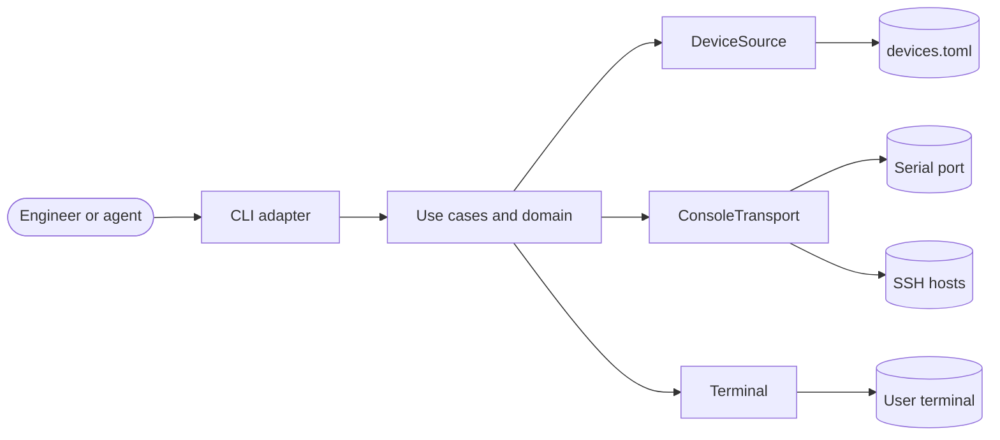

# Architecture: Console Access

## Overview

`consolectl` is a single Rust binary with a hexagonal core. The CLI drives the use cases, and adapters behind driven ports speak TOML, serial, SSH and the terminal; only `main.rs` builds adapters.



## Ports

### DeviceSource

Loads the configured devices. The use cases drive it once per invocation.

```rust
pub trait DeviceSource {
    fn load(&self) -> Result<Vec<Device>, ConfigError>;
}
```

### ConsoleTransport

Opens one console path, hop by hop, and gives back a byte stream. Each hop has its own timeout.

```rust
pub trait ConsoleTransport {
    fn open(&self, path: &ConsolePath) -> Result<Box<dyn ConsoleStream>, OpenError>;
}
```

### Terminal

The user's terminal in raw mode, restored on every exit path.

```rust
pub trait Terminal {
    fn attach(&self, stream: Box<dyn ConsoleStream>) -> Result<Detach, TerminalError>;
}
```

## Adapters

| Adapter | Implements | Technology |
| --- | --- | --- |
| TomlDevices | DeviceSource | `toml` and `serde` |
| SerialTransport | ConsoleTransport, serial hops | `serialport` |
| SshTransport | ConsoleTransport, SSH hops | `russh` |
| RawTerminal | Terminal | `crossterm` |
| Cli | the inbound side | `clap` |

## Runtime

One invocation, one thread for the core. An open session copies bytes in both directions on two threads joined at detach. Each hop has a 10 second connect timeout. A failed hop ends the command with the hop named, and no hop is retried. `Ctrl-]` detaches; the terminal is restored on detach, on error and on a signal.

## Technology

| Choice | For | Why |
| --- | --- | --- |
| Rust | the whole binary | One static binary for macOS and Linux |
| `russh` | SSH hops | Pure Rust, so the binary stays static |
| `serialport` | serial hops | The common choice, and it handles both platforms |

## Layers

`domain` holds devices and console paths and imports nothing. `app` holds the use cases and the ports, and imports `domain`. `adapters` and `cli` import `app` and `domain`. `main.rs` wires everything.

## Decisions

- Console paths are validated when the configuration loads, so a bad path fails before any hop is opened (an engineer sees the mistake without waiting on a timeout).
